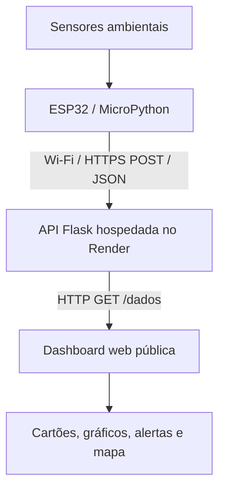
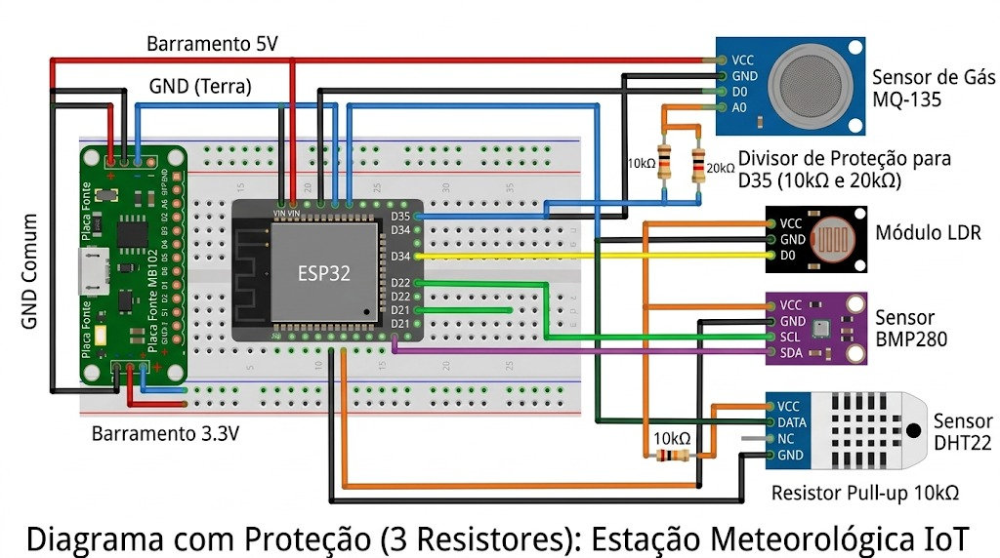
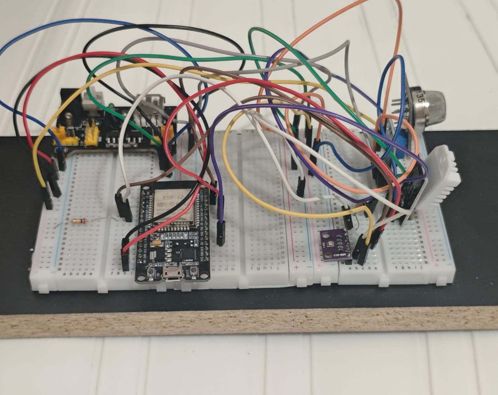
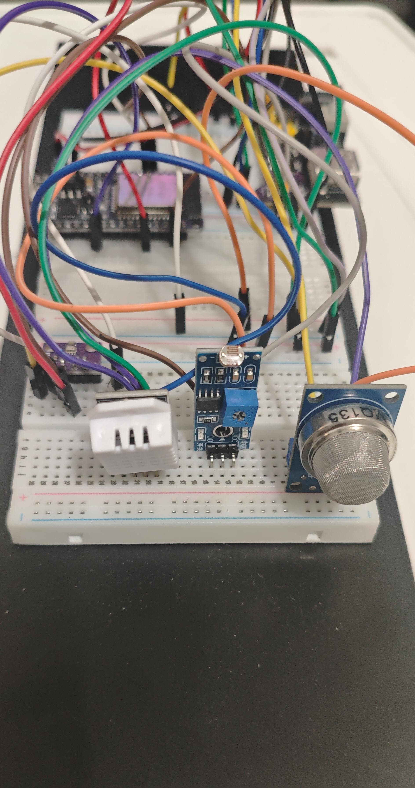
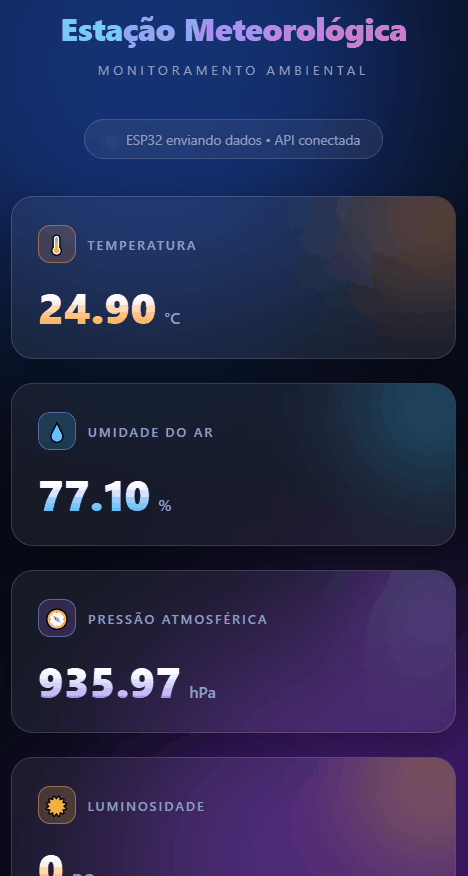
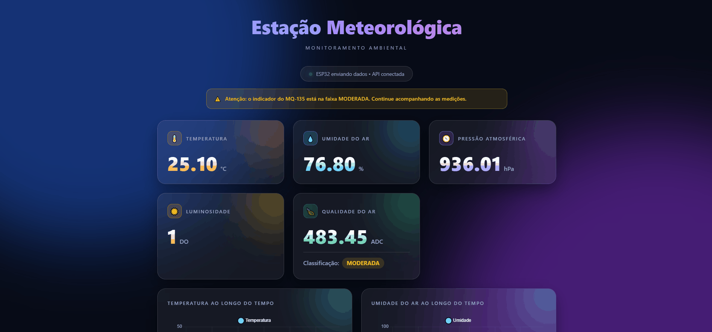

# Estação Meteorológica Inteligente com ESP32

Projeto de uma estação meteorológica de baixo custo para monitoramento de condições ambientais. A estação utiliza uma **ESP32 com MicroPython** e sensores para coletar informações do ambiente, envia as leituras por Wi-Fi/HTTPS para uma **API desenvolvida em Flask** e disponibiliza os dados em uma **dashboard web pública**.

O projeto foi desenvolvido com foco em Internet das Coisas (IoT), monitoramento ambiental e divulgação pública das leituras coletadas por uma estação física.

- **Dashboard:** https://estacao-meteorologica-api.onrender.com/dashboard
- **API:** https://estacao-meteorologica-api.onrender.com/
- **Dados dos sensores:** https://estacao-meteorologica-api.onrender.com/dados
- **Repositório:** https://github.com/ThiagoEG/Estacao-Meteorologica-API

## Visão geral

O funcionamento do sistema é dividido em três partes:

1. **ESP32:** realiza a leitura dos sensores, trata os valores e organiza os resultados em um objeto JSON.
2. **API Flask:** recebe os dados enviados pela ESP32, valida os campos e disponibiliza a leitura mais recente por meio de rotas HTTP.
3. **Dashboard:** consulta a API e apresenta os valores em uma página web, com cartões, gráficos, alertas e mapa.

### Arquitetura



## Tecnologias utilizadas

- **MicroPython:** programação da ESP32.
- **Flask:** desenvolvimento da API em Python.
- **HTML, CSS e JavaScript:** construção e atualização da dashboard.
- **Chart.js:** gráficos da dashboard.
- **Leaflet e OpenStreetMap:** mapa interativo.
- **Render:** hospedagem da API e da aplicação web.
- **Git e GitHub:** versionamento e disponibilização do código-fonte.

## Sensores utilizados

| Sensor | Informação coletada | Interface / pino na ESP32 |
|---|---|---|
| DHT22 | Temperatura e umidade relativa do ar | DATA: GPIO 4 |
| BMP280 | Pressão atmosférica | I²C: SDA GPIO 21 e SCL GPIO 22; endereço `0x76` |
| LDR (módulo com saída DO) | Estado digital relacionado à luminosidade | DO: GPIO 34 |
| MQ-135 | Resposta analógica utilizada como indicador experimental da qualidade do ar | AO: GPIO 35 (ADC), com divisor resistivo externo |

### Observações sobre as leituras

- **DHT22:** fornece temperatura em graus Celsius (°C) e umidade relativa em porcentagem (%). O firmware mantém a última leitura válida caso ocorra uma falha de leitura.
- **BMP280:** a pressão é convertida de Pascal (Pa) para hectopascal (hPa) antes de ser enviada à API. O endereço I²C utilizado é `0x76`. A leitura corresponde à pressão local medida na estação; não é aplicada correção para o nível do mar.
- **LDR:** o projeto utiliza a saída digital (DO). Portanto, a leitura é um estado lógico (`0` ou `1`), e não uma medição em lux. No módulo atualmente testado, `1` representa escuro e `0` representa claro. O potenciômetro do módulo ajusta o limiar de comutação.
- **MQ-135:** a saída analógica é lida pelo ADC da ESP32 no GPIO 35, por meio de um divisor de tensão. O firmware calcula a média de 20 amostras para reduzir pequenas oscilações.

A classificação experimental do MQ-135 utilizada no firmware é:

| Média ADC | Classificação apresentada |
|---:|---|
| Até 410 | `EXCELENTE` |
| Acima de 410 até 450 | `BOA` |
| Acima de 450 até 550 | `MODERADA` |
| Acima de 550 até 700 | `RUIM` |
| Acima de 700 | `PESSIMA` |

Essas faixas foram definidas a partir dos testes realizados com o módulo utilizado no projeto. **Não são um índice oficial de qualidade do ar, não identificam quais gases estão presentes e não devem ser utilizadas como comprovação de que o ar está seguro.**

## Montagem e esquemático eletrônico

O circuito utiliza uma ESP32 DevKit V1, protoboard e os sensores listados acima. As conexões de alimentação e os GNDs devem seguir a montagem física validada.

**Esquemático eletrônico da montagem:**



## Estrutura do repositório

```text
Estacao-Meteorologica-API/
├── app.py
├── requirements.txt
├── render.yaml
├── README.md
├── esp32/
│   ├── main.py
│   └── bmp280.py
├── templates/
│   └── index.html
├── static/
│   ├── style.css
│   └── script.js
└── media/
     ├── Geral.jpg
     ├── Sensores.jpg
     ├── dashboard-desktop.gif
     ├── dashboard-mobile.gif
     └── dashboard-alertas.gif
```
## GUIA DE INSTALAÇÃO

## Configuração da ESP32

O firmware está na pasta `esp32/` e utiliza MicroPython.

Se necessário instale o firmware micropython na sua esp32.
Com Thonny IDE, ao conectar a esp32 em seu pc, abra a tela ferramentas
então opções > Interpretador escolha Micropython (esp32) então selecione
a porta em que está seu esp32 e instale.

### 1. Credenciais Wi-Fi

No arquivo `esp32/main.py`, configure o nome e a senha da rede Wi-Fi:

```python
WIFI_SSID = "NOME_DA_REDE"
WIFI_PASSWORD = "SENHA_DA_REDE"
```

### 2. Endereço da API

O firmware envia os dados para o endpoint:

```python
API_URL = "https://estacao-meteorologica-api.onrender.com/dados"
```

mude de acordo com onde está a aplicação. esta configuração está em `main.py`

### 3. Arquivos necessários na ESP32

Transfira para a ESP32 os arquivos necessários ao firmware, incluindo:

- `main.py`;
- `bmp280.py`;
- a biblioteca `dht` disponibilizada pelo firmware MicroPython;
- a biblioteca `urequests`, caso ela não esteja incluída no firmware utilizado.

O arquivo `bmp280.py` deve estar disponível no dispositivo para que a importação `from bmp280 import BMP280` funcione.

### 4. Executar

Após configurar o Wi-Fi e transferir os arquivos, inicie a ESP32. O programa tenta conectar-se à rede, realiza as leituras dos sensores e envia os dados para a API.

## API

A API foi desenvolvida com Flask e está hospedada no Render.

**Endereço-base:** https://estacao-meteorologica-api.onrender.com/

### Rotas disponíveis

| Método | Rota | Função |
|---|---|---|
| `GET` | `/` | Retorna uma mensagem indicando que a API está disponível. |
| `GET` | `/dados` | Retorna os dados mais recentes recebidos dos sensores. |
| `POST` | `/dados` | Recebe, valida e atualiza os dados enviados pela ESP32. |
| `GET` | `/dashboard` | Exibe a página da dashboard. |

### Formato dos dados

A ESP32 envia um objeto JSON com seis campos:

```json
{
  "temperatura": 26.0,
  "umidade": 77.0,
  "pressao": 934.22,
  "luminosidade": 1,
  "adc_mq135": 350.0,
  "qualidade_ar": "EXCELENTE"
}
```

- `temperatura`: temperatura em °C.
- `umidade`: umidade relativa em %.
- `pressao`: pressão atmosférica em hPa.
- `luminosidade`: estado digital do LDR (`0` ou `1`).
- `adc_mq135`: média das leituras analógicas do MQ-135 (0 a 4095).
- `qualidade_ar`: classificação experimental calculada a partir da leitura ADC do MQ-135.

### Testar a API e acessar a dashboard

- [API — página inicial](https://estacao-meteorologica-api.onrender.com/)
- [API — dados dos sensores](https://estacao-meteorologica-api.onrender.com/dados)
- [Dashboard pública](https://estacao-meteorologica-api.onrender.com/dashboard)

A rota `GET /dados` retorna os valores mais recentes armazenados pela aplicação.

## Dashboard

A dashboard consulta a rota `GET /dados` e atualiza os elementos da página com os valores retornados pela API. O JavaScript utiliza uma atualização automática configurada para ocorrer a cada 1 segundo.

A frequência de consulta da dashboard é independente da frequência de leitura e envio da ESP32. A página pode consultar a API mais vezes do que a ESP32 envia novas medições; nesse caso, algumas consultas apresentarão os mesmos valores até a chegada de uma nova leitura.

## Fotos do protótipo e demonstrações da dashboard

As imagens abaixo devem ser adicionadas ao repositório nos caminhos indicados. O GitHub exibirá as fotografias e reproduzirá os GIFs diretamente nesta página.

### Protótipo físico

**Visão geral da estação montada:**



**Detalhes da ESP32, dos sensores e das conexões:**



### Dashboard web

**Demonstração da dashboard em computador:**


**Demonstração da dashboard em celular:**



**Demonstração dos alertas e indicadores da dashboard:**



## Como executar a API localmente

É necessário ter Python instalado.

1. Clone o repositório:

```bash
git clone https://github.com/ThiagoEG/Estacao-Meteorologica-API.git
```

2. Entre na pasta do projeto:

```bash
cd Estacao-Meteorologica-API
```

3. Crie e ative um ambiente virtual, se desejar:

```bash
python -m venv .venv
```

No Windows (PowerShell):

```powershell
.\.venv\Scripts\Activate.ps1
```

No Linux/macOS:

```bash
source .venv/bin/activate
```

4. Instale as dependências:

```bash
pip install -r requirements.txt
```

5. Inicie a aplicação:

```bash
python app.py
```

Com a aplicação em execução, acesse:

- Dashboard local: http://127.0.0.1:5000/dashboard
- Dados locais: http://127.0.0.1:5000/dados
- Página inicial: http://127.0.0.1:5000/

## Limitações atuais

- Os dados são mantidos em memória pela aplicação Flask. Não há banco de dados. Após uma reinicialização do processo, a última leitura pode ser perdida até a ESP32 enviar novos dados.
- A leitura digital do LDR não fornece valores em lux. O sensor indica apenas 0 (claro) e 1(escuro). O sensor foi calibrado para detectar apenas mudanças de dia e noite.
- A localização exibida no mapa é configurada manualmente a estação não utiliza GPS.
- A disponibilidade da aplicação depende do serviço de hospedagem e da conexão de rede da ESP32.

## Possíveis melhorias futuras

- Utilizar uma leitura analógica do sensor de luminosidade para obter medidas mais detalhadas.
- Implementar persistência dos dados para manter histórico de medições.
- Avaliar melhorias de proteção e encapsulamento para operação contínua em ambiente externo.

---

Projeto e desenvolvimento, Ciência da Computação — Estação Meteorológica Inteligente.
