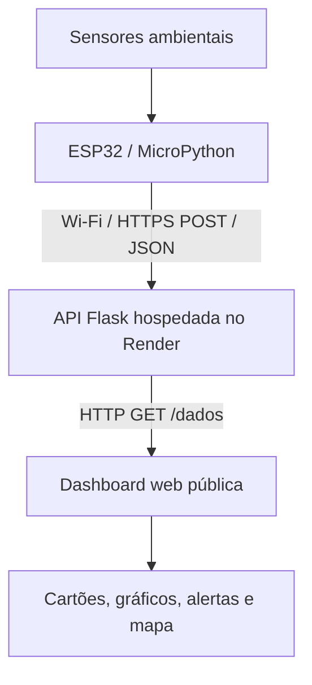
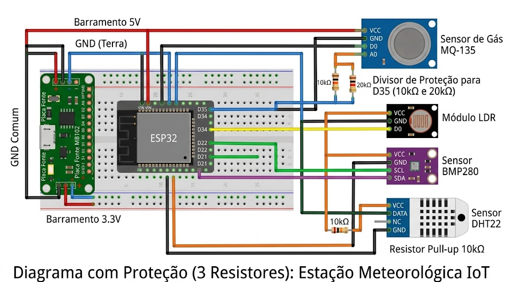
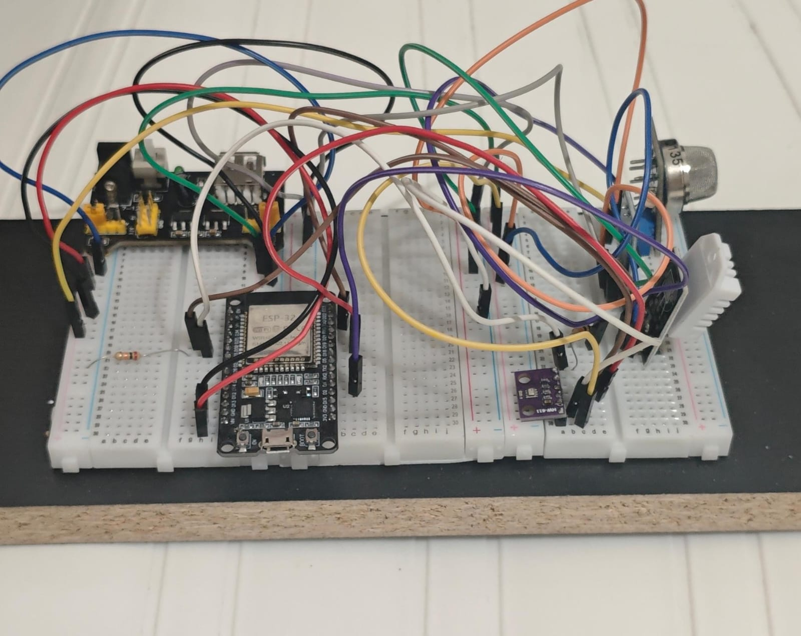
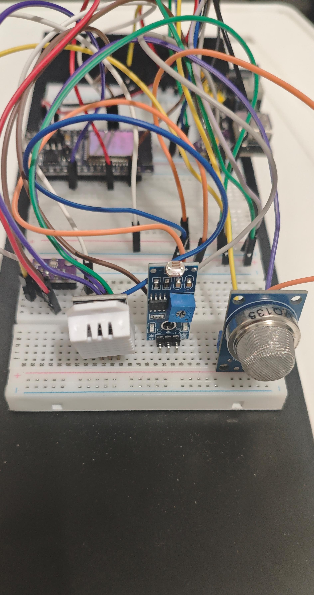

## Vídeo de apresentação

[Assistir ao vídeo de apresentação da Estação Meteorológica Inteligente](https://www.youtube.com/watch?v=jK29W2TPYUw)

# Estação Meteorológica Inteligente com ESP32

Projeto de uma estação meteorológica de baixo custo para monitoramento de condições ambientais. A estação utiliza uma **ESP32 com MicroPython** e sensores para coletar informações do ambiente, envia as leituras por Wi-Fi/HTTPS para uma **API desenvolvida em Flask** e disponibiliza os dados em uma **dashboard web pública**.

O projeto foi desenvolvido com foco em Internet das Coisas (IoT), monitoramento ambiental e divulgação pública das leituras coletadas por uma estação física.

## Acessos públicos

- **Dashboard:** https://estacao-meteorologica-api.onrender.com/dashboard
- **API:** https://estacao-meteorologica-api.onrender.com/
- **Dados dos sensores:** https://estacao-meteorologica-api.onrender.com/dados
- **Repositório:** https://github.com/ThiagoEG/Estacao-Meteorologica-API

## Visão geral

O funcionamento do sistema é dividido em três partes:

1. **ESP32:** realiza a leitura dos sensores, processa os valores e organiza os resultados em um objeto JSON.
2. **API Flask:** recebe os dados enviados pela ESP32, valida os campos e disponibiliza a medição mais recente por meio de rotas HTTP.
3. **Dashboard:** consulta a API e apresenta os valores em uma página web, com cartões, gráficos, alertas e mapa.

### Arquitetura



## Tecnologias utilizadas

- **MicroPython:** programação da ESP32.
- **Flask:** desenvolvimento da API em Python.
- **HTML, CSS e JavaScript:** construção e atualização da dashboard.
- **Chart.js:** geração dos gráficos.
- **Leaflet e OpenStreetMap:** mapa interativo.
- **Render:** hospedagem da API e da aplicação web.
- **Git e GitHub:** versionamento e disponibilização do código-fonte.

## Sensores utilizados

| Sensor | Informação coletada | Interface / pino na ESP32 |
|---|---|---|
| DHT22 | Temperatura e umidade relativa do ar | DATA: GPIO 4 |
| BMP280 | Pressão atmosférica | I²C: SDA GPIO 21, SCL GPIO 22; endereço `0x76` |
| LDR (módulo com saída DO) | Estado digital relacionado à luminosidade | DO: GPIO 34 |
| MQ-135 | Resposta analógica utilizada no cálculo do indicador e da estimativa em PPM | AO: GPIO 35 (ADC), com divisor resistivo externo |

### Funcionamento e tratamento das leituras

**DHT22**

O DHT22 fornece temperatura em graus Celsius (°C) e umidade relativa em porcentagem (%). O firmware realiza a leitura a cada 2 segundos e mantém os últimos valores válidos caso ocorra uma falha de leitura.

**BMP280**

O BMP280 comunica-se com a ESP32 por I²C, no endereço `0x76`. O driver fornece a pressão em Pascal (Pa), que é convertida para hectopascal (hPa). O firmware aplica um offset de `-10.0 hPa` à pressão convertida:

```python
pressao_bruta = bmp_sensor.pressure / 100
pressao = pressao_bruta - 10.0
```

O offset é uma correção adotada na estação, feita de acordo com uma estação próxima.

**LDR**

O projeto utiliza a saída digital (DO) do módulo LDR. Portanto, a estação recebe um estado lógico (`0` ou `1`), e não uma medição contínua em lux:

- `0`: ambiente claro.
- `1`: ambiente escuro.

O potenciômetro do módulo foi ajustado com auxílio de um luxímetro para um limiar de comutação próximo de **38 lux**. Esse valor representa o ponto aproximado de mudança da saída digital, não uma leitura de lux transmitida pela estação.

O GPIO 34 detecta as transições da saída DO por interrupção. O firmware confirma o novo estado após 50 ms sem novas transições, reduzindo mudanças causadas por oscilações rápidas do sinal.

**MQ-135**

A saída analógica AO do MQ-135 é conectada ao GPIO 35 por meio de um divisor resistivo externo:

- `R1 = 10 kΩ`: entre AO e GPIO 35.
- `R2 = 20 kΩ`: entre GPIO 35 e GND.

O firmware utiliza o ADC de 12 bits com atenuação de 11 dB e calcula a média de 20 amostras. A tensão do GPIO é obtida por `read_uv()` e multiplicada pelo fator do divisor (`1,5`) para estimar a tensão na saída AO do módulo.

A partir da tensão AO e da referência configurada de `0,5302 V`, o firmware calcula a razão `Rs/R0` e aplica a equação utilizada no projeto para obter a estimativa numérica em PPM.

A classificação apresentada na dashboard utiliza as seguintes faixas:

| PPM estimado | Indicador |
|---:|---|
| Até 234,2 | `EXCELENTE` |
| Acima de 234,2 até 609,1 | `BOA` |
| Acima de 609,1 até 1.953,0 | `MODERADA` |
| Acima de 1.953,0 até 7.041,6 | `RUIM` |
| Acima de 7.041,6 | `PESSIMA` |

Durante os testes, o sensor MQ-135 foi exposto a vapores de álcool para observar sua reação à presença de substâncias no ambiente. A partir das variações nas leituras analógicas (ADC) e na tensão medida, foi ajustada a conversão utilizada pelo firmware para apresentar os resultados em PPM. As faixas de classificação foram definidas com base no comportamento observado na montagem do projeto e na conversão dos limites ADC utilizados durante os testes. Como o ensaio foi realizado com álcool, sem uma concentração controlada e certificada, os valores em PPM devem ser considerados referências do comportamento do sensor, e não medições absolutamente fiéis da concentração de gases. Portanto, não representam um índice oficial de qualidade do ar, não identificam individualmente os gases presentes e não devem ser utilizados para avaliar riscos à saúde ou condições de segurança.

## Montagem e esquemático eletrônico

O circuito utiliza uma ESP32 DevKit V1, protoboard e os sensores listados nesta documentação. As conexões de alimentação, sinal e GND devem seguir o esquemático e a montagem física validados.



## Estrutura do repositório

```text
Estacao-Meteorologica-API/
├── app.py
├── requirements.txt
├── render.yaml
├── README.md
├── esp32/
│   ├── main.py
│   └── bmp280.py
├── templates/
│   └── index.html
├── static/
│   ├── style.css
│   └── script.js
└── media/
    ├── diagrama_eletrico.jpg
    ├── Geral.jpg
    ├── Sensores.jpg
    ├── dashboard-desktop.gif
    ├── dashboard-mobile.gif
    └── dashboard-alertas.gif
```

## Configuração da ESP32

O firmware está na pasta `esp32/` e utiliza MicroPython.

### 1. Instalação do MicroPython

Se necessário, instale o firmware MicroPython na ESP32. No Thonny, conecte a placa ao computador, abra **Ferramentas → Opções → Interpretador**, selecione **MicroPython (ESP32)** e escolha a porta serial correspondente. Utilize a opção de instalação do firmware quando a placa ainda não estiver preparada.

### 2. Credenciais Wi-Fi

No arquivo `esp32/main.py`, configure o nome e a senha da rede Wi-Fi:

```python
WIFI_SSID = "NOME_DA_REDE"
WIFI_PASSWORD = "SENHA_DA_REDE"
```

### 3. Endereço da API

O firmware envia as medições para o endpoint configurado em `API_URL`:

```python
API_URL = "https://estacao-meteorologica-api.onrender.com/dados"
```

Altere o endereço quando a API estiver hospedada em outro domínio ou for executada em ambiente local.

### 4. Arquivos necessários na ESP32

Transfira para a placa os arquivos necessários ao firmware:

- `main.py`;
- `bmp280.py`;
- a biblioteca `dht`, disponibilizada pelo firmware MicroPython;
- a biblioteca `urequests`, caso ela não esteja incluída no firmware utilizado.

O arquivo `bmp280.py` deve estar disponível no dispositivo para que a importação `from bmp280 import BMP280` funcione.

### 5. Execução

Após configurar o Wi-Fi e transferir os arquivos, reinicie a ESP32. O programa ativa a interface de rede, tenta conectar-se ao Wi-Fi, realiza as leituras dos sensores e envia os dados à API.

## API

A API foi desenvolvida com Flask e está hospedada no Render.

**Endereço-base:** https://estacao-meteorologica-api.onrender.com/

### Rotas disponíveis

| Método | Rota | Função |
|---|---|---|
| `GET` | `/` | Retorna uma mensagem indicando que a API está disponível. |
| `GET` | `/dados` | Retorna a medição mais recente recebida dos sensores. |
| `POST` | `/dados` | Recebe, valida e armazena os dados enviados pela ESP32. |
| `GET` | `/dashboard` | Exibe a dashboard web. |

### Formato dos dados

A ESP32 envia um objeto JSON com sete campos:

```json
{
  "temperatura": 26.6,
  "umidade": 66.5,
  "pressao": 923.4,
  "luminosidade": 1,
  "adc_mq135": 253.15,
  "ppm": 72.3,
  "indicador_ppm_estimado": "EXCELENTE"
}
```

| Campo | Descrição |
|---|---|
| `temperatura` | Temperatura em graus Celsius (°C). |
| `umidade` | Umidade relativa do ar em porcentagem (%). |
| `pressao` | Pressão atmosférica em hectopascal (hPa), após a aplicação do offset configurado. |
| `luminosidade` | Estado digital do LDR: `0` para claro e `1` para escuro. |
| `adc_mq135` | Média das leituras analógicas do MQ-135, em escala ADC de 0 a 4095. |
| `ppm` | Valor numérico calculado pelo modelo implementado no firmware. |
| `indicador_ppm_estimado` | Classificação calculada a partir das faixas de PPM configuradas no projeto. |

### Testar a API e acessar a dashboard

- [API — página inicial](https://estacao-meteorologica-api.onrender.com/)
- [API — dados dos sensores](https://estacao-meteorologica-api.onrender.com/dados)
- [Dashboard pública](https://estacao-meteorologica-api.onrender.com/dashboard)

## Dashboard

A dashboard consulta a rota `GET /dados` e atualiza os cartões, indicadores e gráficos com os valores retornados pela API. O JavaScript realiza consultas à API a cada 1 segundo.

A frequência de consulta da dashboard é independente da frequência de leitura e envio da ESP32. A página pode consultar a API mais vezes do que a ESP32 envia novas medições; nesse caso, as consultas apresentam os mesmos valores até a chegada de uma nova medição.

A dashboard apresenta:

- cartões com as leituras mais recentes dos sensores;
- gráfico histórico de temperatura;
- gráfico histórico de umidade;
- gráfico histórico de pressão;
- gráfico histórico do PPM estimado;
- indicador visual e alertas associados à classificação;
- mapa com a localização aproximada configurada para a estação.

## Fotos do protótipo e demonstrações da dashboard

### Protótipo físico





### Dashboard web


## Funcionamento do firmware

O firmware utiliza temporizadores para sinalizar a leitura do DHT22 a cada 2 segundos e o ciclo de envio a cada 1 segundo. As rotinas dos temporizadores apenas sinalizam os eventos; as leituras e operações de comunicação são executadas no loop principal.

A interrupção externa do GPIO 34 detecta mudanças na saída digital do LDR. O estado é confirmado no loop principal após o intervalo de estabilização configurado.

O controle de Wi-Fi realiza tentativas de conexão com limite de 15 segundos e intervalo de 5 segundos entre novas tentativas. Durante uma queda de conexão, as leituras dos sensores continuam, mas as medições que não conseguem ser enviadas não ficam armazenadas para transmissão posterior.

## Testes realizados

Os testes registrados durante o desenvolvimento incluem:

- **DHT22:** teste de resposta à elevação da temperatura, com aumento observado na leitura ao aproximar uma fonte de calor do sensor. O teste demonstra resposta à variação, não exatidão absoluta.
- **Wi-Fi:** desconexão e reconexão da rede. As leituras dos sensores continuaram durante a interrupção e o envio foi retomado após a reconexão.
- **MQ-135:** testes de estabilidade das leituras, cálculo da razão `Rs/R0` e integração da estimativa em PPM e do indicador à transmissão JSON.
- **LDR:** ajuste do limiar de comutação com auxílio de luxímetro, com transição observada próximo de 38 lux.
- **API:** validação de valores recebidos e rejeição de dados fora das faixas configuradas.

## Como executar a API localmente

É necessário ter Python instalado.

### 1. Clonar o repositório

```bash
git clone https://github.com/ThiagoEG/Estacao-Meteorologica-API.git
```

### 2. Entrar na pasta do projeto

```bash
cd Estacao-Meteorologica-API
```

### 3. Criar e ativar um ambiente virtual

```bash
python -m venv .venv
```

No Windows (PowerShell):

```powershell
.\.venv\Scripts\Activate.ps1
```

No Linux/macOS:

```bash
source .venv/bin/activate
```

### 4. Instalar as dependências

```bash
pip install -r requirements.txt
```

### 5. Iniciar a aplicação

```bash
python app.py
```

Com a aplicação em execução, acesse:

- Dashboard local: http://127.0.0.1:5000/dashboard
- Dados locais: http://127.0.0.1:5000/dados
- Página inicial: http://127.0.0.1:5000/

## Limitações atuais

- Os dados são mantidos em memória pela aplicação Flask. Não há banco de dados. Após uma reinicialização do processo, a última medição pode ser perdida até a ESP32 enviar novos dados.
- O histórico dos gráficos é mantido temporariamente no navegador e limitado à quantidade de pontos configurada no JavaScript.
- A saída digital do LDR não fornece valores contínuos em lux; informa apenas os estados claro (`0`) e escuro (`1`).
- A localização exibida no mapa é configurada manualmente; a estação não utiliza módulo GPS.
- A disponibilidade da aplicação depende do serviço de hospedagem e da conexão de rede da ESP32.

## Possíveis melhorias futuras

- Sensor de luminosidade com saída analógica apropriada para obter medições em lux.
- Implementar persistência dos dados para manter um histórico entre reinicializações.
- Adicionar autenticação ao recebimento de dados pela API.
- Aprimorar o tratamento de falhas e o tempo limite das requisições HTTPS.
- Realizar comparações adicionais dos sensores com instrumentos de referência.
- Aprimorar a proteção física dos componentes para operação contínua em ambiente externo.

---

Projeto e desenvolvimento — Ciência da Computação — Estação Meteorológica Inteligente.
